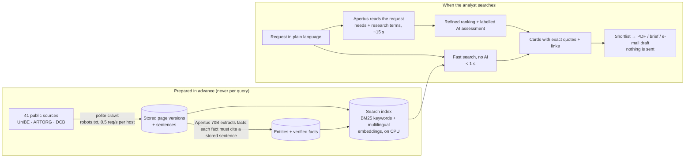

# Bern Match

Bern Match helps the Bern Economic Development Agency find **who to contact** at the University of Bern (UniBE), ARTORG and Diabetes Center Berne. An analyst describes a company's need in plain language (EN/DE/FR/IT) and builds a **shortlist** of research groups, labs, platforms, projects and people. Every entry quotes the exact source sentence and links to its page, and the shortlist exports to PDF for the team.

**Demo video (1:42):** [watch on Google Drive](https://drive.google.com/file/d/1ncMDIrwjjgFb5TwF-v2jZufNjyDfvVSe/view?usp=sharing) · **Live demo:** https://kaktamsdengami-bern-match.hf.space

Powered by [Apertus](https://www.swiss-ai.org/apertus), the Swiss open language model, served on Swiss infrastructure through the [Keera](https://keera.ch) gateway (CSCS). The first results never wait for the AI.

## How it works



1. **Prepared in advance.** We crawl the supplied public institutional sites once, within fixed page budgets (see [Crawling safeguards](#crawling-safeguards)). We store every page version and split it into sentences. Apertus 70B extracts entities (people, groups, platforms, projects) and facts (expertise, role, infrastructure, projects). **Code rejects any fact that does not point to an exact stored sentence.** Then we build one index: SQLite FTS5 (BM25) plus multilingual-e5-small embeddings (ONNX, CPU).
2. **Fast search, under a second, with no AI on this path.** Keyword and meaning search run in parallel and are fused. Each entity takes one place, however many pages it has. News items and navigation pages are not shown as contacts. A deterministic policy labels the answer *confident*, *low confidence*, *too broad* or *no evidence*.
3. **Refinement with Apertus, in the background.** Apertus 70B reads the request ("How we read your request"): it turns it into needs and research terms in English and German, checks that the request is in scope, and refuses nonsense. A second search over those terms produces a refined ranking that the analyst can accept. Apertus also writes short per-candidate assessments, always labelled as AI. If Apertus is slow, 8B takes over; if Apertus is down, the fast results stay.
4. **Shortlist, the result.** The analyst collects contacts across several searches, adds notes and exports a PDF with the sources. A one-page brief and an e-mail draft (Apertus, labelled, never sent) are optional.

Details: [Architecture](docs/ARCHITECTURE.md) · [Search](app/search/README.md) · [Extraction](docs/extraction.md) · [Grounding](docs/grounding.md) · [Interpretation](docs/interpretation.md) · [Assessment](docs/assessment.md)

## Measured results

Frozen gold set 0.3: 36 real partner-search questions in 5 languages, split into development (for tuning) and evaluation (never tuned on). Numbers are from the live service on 19 Oct 2026 unless stated otherwise.

| | Result |
| --- | --- |
| Recall@10, evaluation split (n = 17) | 0.47 first baseline → **0.77 instant** → **0.82 after Apertus refinement** |
| Recall@10, development split (n = 17) | 0.82 (instant and refined) |
| Cards linking to their source | **100%** |
| Quotes identical to the stored sentence | **100%** (automatic check, 0 mismatches) |
| Red-team (18 adversarial queries) | 0 violations (18 Oct) |
| Server time, first results | median ≈ 0.26 s, p95 ≈ 0.5 s |
| Full Apertus pipeline | median ≈ 14–17 s |
| 10 concurrent users | p95 ≈ 3 s (18 Oct) |

**Which model does what, and why** ([report](docs/report/ai-evaluation-cost.md)):
- **Apertus 70B:** fact extraction (offline), request interpretation and expansion, assessments. Expansion raised evaluation recall from 0.65 to 0.82 in a controlled run.
- **Apertus 8B:** about 4× faster, but its expansion added nothing over plain search. It is used only as a timeout fallback.
- **multilingual-e5-small:** embeddings on the fast path.

**Tried, measured, not shipped:**
- a cross-encoder reranker (no gain on the deployed CPU, +1.2 s per search);
- cutting weaker cards (lost 2 of 17 evaluation answers);
- a stricter extraction prompt plus a 54% larger crawl (E1: field completeness fell from 26% to 20%);
- several ranking tweaks.

Full list in [docs/report/data-search.md](docs/report/data-search.md).

**Honest gaps:**
- Structured fields are filled on about a quarter of cards. Every card still has its quote.
- Ranks 4–10 are often weak matches.
- Samples are small.
- The 2 absent-answer evaluation questions still return cards.
- The air-gapped run is prepared ([docs/offline-docker.md](docs/offline-docker.md)) but not yet recorded.

## Crawling safeguards

We do not load the sources heavily, and we never crawl at query time.
- **robots.txt is obeyed.** If robots.txt cannot be read, the site is not crawled (fail closed). Redirects outside the allowed domains are refused.
- **At most 0.5 requests per second per host**, with an identifying User-Agent (`BernMatch/0.1 (public research source snapshot)`).
- **Backoff on 408 / 429 / 5xx:** at most 3 attempts, and `Retry-After` is honoured (capped at 10 s).
- **Fixed budgets** per source: page count, link depth, sitemaps, discovered URLs, and 10 MB per response ([config/sources/crawl_profiles.json](config/sources/crawl_profiles.json)).
- **Only the supplied public domains.** Fetched pages are cached and reused; unchanged pages are not re-fetched.
- **Searches only read the stored corpus.** No request ever triggers a live fetch.

## Production readiness

**Done:**
- one-command deploy with smoke test and rollback;
- the index restores from storage in about 7 s;
- feedback and admin state survive restarts;
- rate limiting;
- protected admin routes with per-source coverage;
- suppression and removal (`410`);
- an incremental index build that reuses vectors of unchanged text;
- `docker compose up` for a local or sovereign run ([docs/offline-docker.md](docs/offline-docker.md)).

**Needed for production:**
- Swiss or on-premises hosting instead of the demo Space;
- scheduled refresh crawls;
- monitoring and alerting;
- single sign-on for analysts;
- a staffed removal-request contact (to do);
- a recorded air-gapped acceptance run.

**Scaling:**
- The fast path is CPU-only and stateless per request. More users means more replicas behind a load balancer, sharing one read-only index.
- Apertus calls are bounded per request and run in the background.

**Cost** ([docs/costs.md](docs/costs.md)):
- Hosting dominates: the demo Space costs about USD 22 per month.
- LLM tokens for a full corpus re-processing are a few CHF at placeholder prices.

## Roadmap

- **Full Apertus stack:** replace multilingual-e5 with a Swiss / Apertus embedding model and measure it on the same gold set.
- **Coverage:** ship the larger crawl (E1, +1,529 pages) with an extraction prompt that keeps field completeness, then more faculties and partner institutions.
- **Better cards:** more filled fields; merge language versions of the same page; fold weaker matches.
- **Shortlist for teams:** shared shortlists, contact status, CRM export.
- **Operations:** scheduled refresh, monitoring, removal-request contact, air-gapped acceptance run.

## Run it locally

Python 3.12.

```bash
python -m venv .venv
.venv/bin/python -m pip install -r requirements.lock -r app/search/requirements.txt -r app/ingest/requirements.txt pytest httpx
.venv/bin/python -m pytest -q                      # deterministic tests, no network
```

**UI with synthetic data** (no index, no keys): `BERNMATCH_FIXTURE_MODE=1 .venv/bin/python -m uvicorn app.main:app --port 8000`

**Real search** needs an index built from a corpus export:

```bash
.venv/bin/python -m app.search fetch-model --model small --model-dir models/e5-small
.venv/bin/python -m app.search build --corpus-jsonl corpus.jsonl --knowledge-dir knowledge --model-dir models/e5-small --data-dir data
BERNMATCH_DATA_DIR=data .venv/bin/python -m uvicorn app.main:app --port 8000
```

**Docker:** `docker compose up`. This is the same image as the live Space; put `bundle.tar.gz` in `./offline-data` first ([docs/offline-docker.md](docs/offline-docker.md)).

The corpus is not in this repository because it contains names from public pages. Crawl it with `python -m app.ingest crawl --profile final` ([app/ingest/README.md](app/ingest/README.md)). AI features need `APERTUS_BASE_URL`, `APERTUS_API_KEY` and `APERTUS_MODEL` in a git-ignored `.env` ([env.example](env.example), [docs/inference.md](docs/inference.md)). Without them, search still works and the AI parts report themselves unavailable.

**Evaluation** against a running instance: `python -m evaluation run --base-url http://127.0.0.1:8000 --split development --out runs/dev.json [--enriched]`, then `python -m evaluation report runs/dev.json`.

## Data handling

- Only public professional information from the listed institutional sites is collected.
- Company descriptions typed into the search are not stored and are kept out of logs.
- Anyone named in the index can ask for removal: suppressed records are skipped by the crawler, filtered at serving time and answered with `410` ([docs/data-policy.md](docs/data-policy.md)). The contact address for such requests is still to be published.
- E-mail drafts are never sent by the system.

This is a design commitment, not a claim of legal compliance.

## Documentation

[Architecture](docs/ARCHITECTURE.md) · [Contracts](docs/CONTRACTS.md) · [Decisions](docs/DECISIONS.md) · [Measurements](docs/MEASUREMENTS.md) · [Report: data and search](docs/report/data-search.md) · [Report: AI, evaluation, cost](docs/report/ai-evaluation-cost.md) · [Deployment](docs/deployment.md) · [Offline / Docker](docs/offline-docker.md) · [Attribution and licences](docs/attribution.md)

## Team

Built for the Apertus hackathon (19 October 2026) by Dimitry ([@kaktamsdengami](https://github.com/kaktamsdengami)), Maxim ([@maxim451](https://github.com/maxim451)) and Ruihan ([@AnAsteria](https://github.com/AnAsteria)).

## Licence

[MIT](LICENSE) for the code and documentation in this repository. Source-page content belongs to the publishing institutions; see [Attribution and licences](docs/attribution.md).
