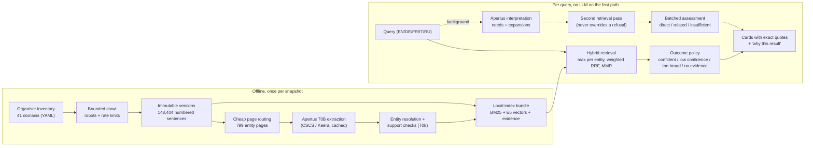

# Architecture and jury evidence (EXTRA G1, #146)

Draft for the report and pitch; numbers come from the run records cited in the other report sections.

## Architecture

Solid arrows are deterministic and run on CPU. Dotted arrows need Apertus and are optional: when the gateway is unavailable, search still works.

## Jury criteria → evidence

| Criterion | What we can show | Evidence |
|---|---|---|
| Purposeful AI | Apertus does the extraction (4,289 supported claims on 2,543 entities), query expansion (evaluation Recall@10 0.65 → 0.82) and assessment. The fast path uses no LLM. 70B vs 8B was chosen by measurement. | #7, #8, #20, `docs/report/ai-evaluation-cost.md`, D10 |
| Technical rigour | Frozen, grouped gold set (36 queries), baseline vs current (0.47 → 0.76), T20 ablations and cross-encoder comparison, byte-identical quote check (0 problems / 2,754 quotes), red-team set (0 violations / 18), disclosed trade-offs (abstention, I17, platform drift) | #16, #20, #119, #130, `docs/evaluation-protocol.md`, `docs/MEASUREMENTS.md` |
| Value, cost and scalability | A search costs 0 LLM tokens; one-off corpus processing ≈ 1.05M + 0.39M tokens; fast path p95 < 0.2 s for one user, ~3 s p95 for 10 concurrent users on 8 vCPU (bottleneck identified) | `docs/costs.md`, #134 |
| Sovereign deployability | Swiss model via the CSCS/Keera gateway; local index and embeddings; fast path ran with all outbound sockets refused (0 attempts). **Gap:** no OS-level air-gapped run with local Apertus 8B | `docs/offline.md`, D13 |
| Implementation feasibility | One container, restart in ~7 s from the bundle, one-command deploy with rollback, feedback persistence, admin coverage page, YAML sources, suppression with 410 (checked on the real index) | #84, #13, #12, `docs/data-policy.md` |
| Pitch and presentation | One fictional-company story, a German query finding English evidence, honest "low confidence" and "too broad" states, inspectable quotes | `docs/demo-script.md` |
