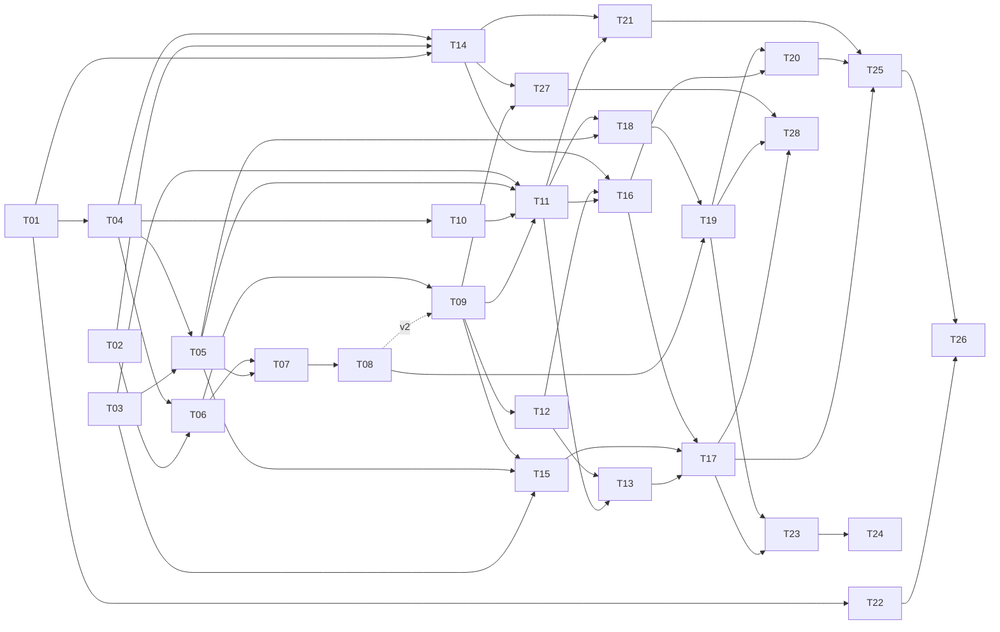

# Proposed delivery plan and GitHub backlog
## Current state, authority and time

This plan is a proposal awaiting human approval and assignment of the dispatcher/integration owner. No coding agents have been started. The architecture is approved; there was no pre-existing approved task plan or concrete contract file. This step supplies proposed contracts/task specifications rather than pretending they were previously approved. Repository inspection found no application implementation. GitHub authentication and repository access were verified outside the sandbox; no existing issues or milestones were found before creation. Existing default GitHub labels were preserved.

Planning baseline: **18 October 2026, 14:05:38 Europe/Zurich**, deadline **19 October 2026, 14:30 Europe/Zurich**: approximately **24h24m**. Three developers provide at most about **73 gross person-hours**, before rest, coordination and access waits. Estimated backlog effort is **88.5 active person-hours**, including 4 hours of deferred Stretch, so the full scope is not credible as a guaranteed delivery. Estimates exclude model downloads and external waits. Recalculate remaining time at dispatch, not from this snapshot.

GitHub is authoritative for execution state: closed issues are DONE only after verified integrated acceptance. The table below maps specifications/dependencies/milestones and gives estimates, not a parallel status system. Check live labels and grants before work. No implementation is marked complete. `docs/backlog/manifest.json`, issue-body files and `github-map.json` are creation/audit artifacts, not execution-status caches.

## Workstreams and ownership

See the [named team allocation and per-person execution order](../TEAM_PLAN.md): Maxim (data/search), Ruihan (Apertus), Dimitry (application/integration), with proposed T14/T22 transfers to balance workload. This proposal does not itself appoint the dispatcher or grant coding tasks.

- **A — Sources, ingestion, evidence storage and search indexes:** one developer with AI/ML background. Owns ingest/storage/index/lifecycle modules and offline assets.
- **B — Apertus integration, extraction, interpretation, assessment and evaluation:** the other AI/ML developer. Proposed sole shared-contract owner, confirmed in T01; owns inference/model schemas/evaluation modules.
- **C — Workspace, API integration, admin, deployment and demo packaging:** general CS developer. Proposed sole dispatcher/integration owner, confirmed before coding grants; owns shared integration/CI/deployment/UI files.

These are roles, not invented participant names. Exactly one dispatcher grants work and exactly one contract owner authorises shared contract changes. C's coordination and artifact duties reduce feature capacity. Review [AGENT_WORKFLOW.md](../AGENT_WORKFLOW.md) and [CONTRACTS.md](../CONTRACTS.md). Dedicated branch/worktree per granted issue; no parallel self-claims.

## Minimal stack proposal

One Python/FastAPI application serves a static JavaScript workspace and API; Pydantic contracts, SQLite metadata/feedback, persistent local NumPy vectors and BM25, multilingual E5-small embeddings, HTML/text-PDF ingestion, HTTP Apertus adapter, SSE asynchronous events, and a single container with persistent volume. Proposed local Apertus runtime: llama.cpp server. Rationale: one deployable runtime, explicit local assets and minimal infrastructure. Pin dependencies/model revisions after compatibility/license checks. This is a concrete proposal, not tested functionality. Hosting is one existing authorised container-capable persistent host selected by T03; access has not been established, so no provider is fabricated. No paid resources will be provisioned in planning.

T01 ratifies contracts/stack/ownership before implementation. T03 selects actual accessible hosting/local hardware. If those gates fail, report the specific blocker; do not invent a second deployment or silent substitute for offline proof.

## Iterations, checkpoints and release gates

Four milestones are the minimum useful separation here: deploy a slice, prove Core, add/measure enrichment, verify submission. Milestone dates below are aggressive checkpoints, not promises. GitHub milestones use date-level due fields; exact Europe/Zurich checkpoint times in this document and milestone descriptions are authoritative. Cross-milestone preparation starts early: T22 artifacts in V1; T14 gold/harness in V1 alongside data; T15 local-asset preparation as soon as access is known; T21 partner scheduling as soon as a human contact is available. Do not wait for every prior milestone to close before independent preparation.

### [V1 — Working vertical slice](https://github.com/AnAsteria/Apertus_Hack/milestone/1) — 11 issues

Target checkpoint: `2026-10-18T18:00:00+02:00` (Europe/Zurich UTC+02). **Acceptance/integration demonstration:** Real permitted pages from all three sources → immutable evidence → persistent BM25+dense indexes → hybrid API/cards; inference config probed; externally accessible initial deployment and restart demonstrated. All task acceptance gates, not code count, required.

### [V2 — Reliable and measured Core](https://github.com/AnAsteria/Apertus_Hack/milestone/2) — 6 issues

Target checkpoint: `2026-10-19T08:00:00+02:00` (Europe/Zurich UTC+02). **Acceptance/integration demonstration:** Integrated multilingual/absence/grounding/fairness/lifecycle/feedback/admin checks, measured Core performance/cost and full local network-blocked unseen query including Apertus 8B. Missing evidence keeps gate open.

### [V3 — Apertus enrichment and comparisons](https://github.com/AnAsteria/Apertus_Hack/milestone/3) — 4 issues

Target checkpoint: `2026-10-19T10:30:00+02:00` (Europe/Zurich UTC+02). **Acceptance/integration demonstration:** Editable requirements and batched validated streamed enrichment preserve fast path; complete required ablations/cross-encoder subset and actual partner review/fixes. Tier labels remain independent of milestone.

### [V4 — Verified release and submission](https://github.com/AnAsteria/Apertus_Hack/milestone/4) — 5 issues

Target checkpoint: `2026-10-19T14:30:00+02:00` (Europe/Zurich UTC+02). **Acceptance/integration demonstration:** Public final smoke test, honest measured report, ≤10-slide pitch PDF, ≤6-page report PDF, ≤2-minute public video/backup, required PDF ZIP and actual submission confirmation. Stretch remains deferred unless Core accepted and buffer protected.

Target schedule: V1 integration on 18 October 18:00; V2 evidence checkpoint 19 October 08:00; V3 enrichment/comparison freeze 10:30; final hosting and artifact freeze 12:30; verification/package by 13:30; **13:30–14:30 reserved submission buffer**. Reserve at least four person-hours for artifact work (T22), two for submission (T26), three for final deploy/release verification (T25), plus Core/integration/partner checks already itemised. Artifact drafting starts on 18 October. Protect rest and explicitly revise checkpoints if access or capacity makes them impossible. Do not spend the buffer on Stretch.

## Dependency graph and critical path

The issue table is the full dependency source. T10 fixture development can start after T04, but acceptance requires T09 real results. T22 outlines start after T01; its final acceptance consumes T16/T20/T25 evidence, without blocking early drafting. T15 downloads/access preparation should start early; its actual unseen-query proof requires the assembled local runtime/corpus. These are start-versus-acceptance distinctions, not permission to bypass grants.

Likely critical chain: **T01 → T04 → T06 → T07 → T08 → T09 → T11**, then lifecycle/admin/Core measurement and offline branches converge at **T17**, while **T18 → T19 → T20** supplies required full evaluation, and **T21** supplies partner review. **T17 + T20 + T21 → T25 → T26**, with **T22** prepared in parallel. Endpoint, source and local-hardware access are critical external paths. B's extraction/evaluation/enrichment load and C's deployment/coordination/artifact load create resource contention beyond graph dependencies; the dispatcher must serialize those owners' shared edits, not assume unlimited parallelism.

## Executable task specifications and issue mapping

Every issue embeds objective, architecture/contract references, scope/ownership, acceptance/checks, definition of done, reporting and claim rules. Dependencies refer to actual GitHub issues. Task files provide self-contained worker prompts. Estimates below are active person-hours, not measured throughput or delivery guarantees.

| Task / specification | GitHub | Milestone | Tier | Stream | Dependencies | Hours | Acceptance gate |
| --- | --- | --- | --- | --- | --- | --- | --- |
| [T01 — Ratify contracts, stack and shared ownership](T01-contracts.md) | [#1](https://github.com/AnAsteria/Apertus_Hack/issues/1) | V1 | core | C | None | 2 | Real-source slice / task §E |
| [T02 — Audit source inventory and real-page evaluation seeds](T02-source-inventory.md) | [#2](https://github.com/AnAsteria/Apertus_Hack/issues/2) | V1 | core | A | None | 2 | Real-source slice / task §E |
| [T03 — Audit endpoint, hosting and local-hardware access](T03-access-audit.md) | [#3](https://github.com/AnAsteria/Apertus_Hack/issues/3) | V1 | core | B | None | 1.5 | Real-source slice / task §E |
| [T04 — Create contract-first application and CI skeleton](T04-scaffold.md) | [#4](https://github.com/AnAsteria/Apertus_Hack/issues/4) | V1 | core | C | [#1](https://github.com/AnAsteria/Apertus_Hack/issues/1) | 3 | Real-source slice / task §E |
| [T05 — Configure and probe replaceable CSCS/Keera inference](T05-inference-adapter.md) | [#5](https://github.com/AnAsteria/Apertus_Hack/issues/5) | V1 | core | B | [#3](https://github.com/AnAsteria/Apertus_Hack/issues/3), [#4](https://github.com/AnAsteria/Apertus_Hack/issues/4) | 3 | Real-source slice / task §E |
| [T06 — Implement bounded initial crawl and immutable evidence storage](T06-ingestion.md) | [#6](https://github.com/AnAsteria/Apertus_Hack/issues/6) | V1 | core | A | [#2](https://github.com/AnAsteria/Apertus_Hack/issues/2), [#4](https://github.com/AnAsteria/Apertus_Hack/issues/4) | 5 | Real-source slice / task §E |
| [T07 — Extract evidence-backed structured facts with Apertus 8B](T07-extraction.md) | [#7](https://github.com/AnAsteria/Apertus_Hack/issues/7) | V1 | core | B | [#5](https://github.com/AnAsteria/Apertus_Hack/issues/5), [#6](https://github.com/AnAsteria/Apertus_Hack/issues/6) | 4 | Real-source slice / task §E |
| [T08 — Resolve entities and validate semantic grounding](T08-entities-grounding.md) | [#8](https://github.com/AnAsteria/Apertus_Hack/issues/8) | V1 | core | B | [#7](https://github.com/AnAsteria/Apertus_Hack/issues/7) | 4 | Real-source slice / task §E |
| [T09 — Build persistent multilingual hybrid retrieval and fair ranking](T09-hybrid-search.md) | [#9](https://github.com/AnAsteria/Apertus_Hack/issues/9) | V1 | core | A | [#6](https://github.com/AnAsteria/Apertus_Hack/issues/6) (v1); [#8](https://github.com/AnAsteria/Apertus_Hack/issues/8) for v2 | 5 | Real-source slice / task §E |
| [T10 — Build inspectable search cards and non-blocking API workspace](T10-workspace.md) | [#10](https://github.com/AnAsteria/Apertus_Hack/issues/10) | V1 | core | C | [#4](https://github.com/AnAsteria/Apertus_Hack/issues/4) | 4 | Real-source slice / task §E |
| [T11 — Integrate vertical slice and deploy early](T11-initial-deployment.md) | [#11](https://github.com/AnAsteria/Apertus_Hack/issues/11) | V1 | core | C | [#3](https://github.com/AnAsteria/Apertus_Hack/issues/3), [#5](https://github.com/AnAsteria/Apertus_Hack/issues/5), [#9](https://github.com/AnAsteria/Apertus_Hack/issues/9), [#10](https://github.com/AnAsteria/Apertus_Hack/issues/10) | 3 | Real-source slice / task §E |
| [T12 — Implement freshness, manual refresh, retirement and suppression](T12-lifecycle.md) | [#12](https://github.com/AnAsteria/Apertus_Hack/issues/12) | V2 | core | A | [#9](https://github.com/AnAsteria/Apertus_Hack/issues/9) | 4 | Verified Core / task §E |
| [T13 — Persist analyst feedback and protected operator administration](T13-feedback-admin.md) | [#13](https://github.com/AnAsteria/Apertus_Hack/issues/13) | V2 | core | C | [#11](https://github.com/AnAsteria/Apertus_Hack/issues/11), [#12](https://github.com/AnAsteria/Apertus_Hack/issues/12) | 4 | Verified Core / task §E |
| [T14 — Build grouped gold set and reproducible evaluation harness](T14-evaluation-harness.md) | [#14](https://github.com/AnAsteria/Apertus_Hack/issues/14) | V2 | core | B | [#1](https://github.com/AnAsteria/Apertus_Hack/issues/1), [#2](https://github.com/AnAsteria/Apertus_Hack/issues/2), [#4](https://github.com/AnAsteria/Apertus_Hack/issues/4) | 4 | Verified Core / task §E |
| [T15 — Preload local assets and prove air-gapped unseen querying](T15-offline-proof.md) | [#15](https://github.com/AnAsteria/Apertus_Hack/issues/15) | V2 | core | A | [#3](https://github.com/AnAsteria/Apertus_Hack/issues/3), [#5](https://github.com/AnAsteria/Apertus_Hack/issues/5), [#9](https://github.com/AnAsteria/Apertus_Hack/issues/9) | 5 | Verified Core / task §E |
| [T16 — Execute Core measurements and cost worksheet](T16-core-benchmarks.md) | [#16](https://github.com/AnAsteria/Apertus_Hack/issues/16) | V2 | core | B | [#11](https://github.com/AnAsteria/Apertus_Hack/issues/11), [#12](https://github.com/AnAsteria/Apertus_Hack/issues/12), [#14](https://github.com/AnAsteria/Apertus_Hack/issues/14) | 4 | Verified Core / task §E |
| [T17 — Verify reliable Core release gate](T17-core-release.md) | [#17](https://github.com/AnAsteria/Apertus_Hack/issues/17) | V2 | core | C | [#13](https://github.com/AnAsteria/Apertus_Hack/issues/13), [#15](https://github.com/AnAsteria/Apertus_Hack/issues/15), [#16](https://github.com/AnAsteria/Apertus_Hack/issues/16) | 3 | Verified Core / task §E |
| [T18 — Add editable needs and multilingual expansion asynchronously](T18-interpretation.md) | [#18](https://github.com/AnAsteria/Apertus_Hack/issues/18) | V3 | second-layer | B | [#5](https://github.com/AnAsteria/Apertus_Hack/issues/5), [#11](https://github.com/AnAsteria/Apertus_Hack/issues/11) | 4 | Measured enrichment/review / task §E |
| [T19 — Add bounded batched assessments and streamed validated enrichment](T19-assessment.md) | [#19](https://github.com/AnAsteria/Apertus_Hack/issues/19) | V3 | second-layer | B | [#8](https://github.com/AnAsteria/Apertus_Hack/issues/8), [#18](https://github.com/AnAsteria/Apertus_Hack/issues/18) | 4 | Measured enrichment/review / task §E |
| [T20 — Execute full Apertus and cross-encoder evaluation](T20-full-ablations.md) | [#20](https://github.com/AnAsteria/Apertus_Hack/issues/20) | V3 | core | B | [#16](https://github.com/AnAsteria/Apertus_Hack/issues/16), [#19](https://github.com/AnAsteria/Apertus_Hack/issues/19) | 4 | Measured enrichment/review / task §E |
| [T21 — Obtain partner review and integrate bounded fixes](T21-partner-review.md) | [#21](https://github.com/AnAsteria/Apertus_Hack/issues/21) | V3 | core | C | [#11](https://github.com/AnAsteria/Apertus_Hack/issues/11), [#14](https://github.com/AnAsteria/Apertus_Hack/issues/14) | 3 | Measured enrichment/review / task §E |
| [T22 — Prepare pitch, report, demo and attribution early](T22-artifact-preparation.md) | [#22](https://github.com/AnAsteria/Apertus_Hack/issues/22) | V4 | core | C | [#1](https://github.com/AnAsteria/Apertus_Hack/issues/1) | 4 | Release/artifacts / task §E |
| [T23 — Optional one-page brief with tracked provenance edits](T23-brief.md) | [#23](https://github.com/AnAsteria/Apertus_Hack/issues/23) | V4 | stretch | C | [#17](https://github.com/AnAsteria/Apertus_Hack/issues/17), [#19](https://github.com/AnAsteria/Apertus_Hack/issues/19) | 3 | Release/artifacts / task §E |
| [T24 — Optional email draft last, never automatic sending](T24-email.md) | [#24](https://github.com/AnAsteria/Apertus_Hack/issues/24) | V4 | stretch | C | [#23](https://github.com/AnAsteria/Apertus_Hack/issues/23) | 1 | Release/artifacts / task §E |
| [T25 — Verify final hosting, release evidence and repository readiness](T25-final-deployment.md) | [#25](https://github.com/AnAsteria/Apertus_Hack/issues/25) | V4 | core | C | [#17](https://github.com/AnAsteria/Apertus_Hack/issues/17), [#20](https://github.com/AnAsteria/Apertus_Hack/issues/20), [#21](https://github.com/AnAsteria/Apertus_Hack/issues/21) | 3 | Release/artifacts / task §E |
| [T26 — Package final artifacts and confirm submission before deadline](T26-submission.md) | [#26](https://github.com/AnAsteria/Apertus_Hack/issues/26) | V4 | core | C | [#22](https://github.com/AnAsteria/Apertus_Hack/issues/22), [#25](https://github.com/AnAsteria/Apertus_Hack/issues/25) | 2 | Release/artifacts / task §E |
| [T27 — Accept queries in EN/DE/FR/IT/RU and retrieve EN/DE/FR/IT evidence](T27-multilingual-query.md) | issue not yet created | V2 | core | A | T09, T14 | 2 | Verified Core / task §E |
| [T28 — Optional localized interface, explanations and translated evidence](T28-localized-ui-answers.md) | issue not yet created | V4 | stretch | C+B | T17, T19, T27 | 3 | Release/artifacts / task §E |

## Revision R1 (2026-10-18)

Proposed by Maxim after the organiser inventory and the T03 access audit arrived; **pending confirmation by Ruihan and Dimitry**. Task specifications carry a "Revision R1" block in section A. GitHub issue bodies, labels and new issues are not yet synchronised; the dispatcher does that after confirmation.

1. **Sources:** the organiser inventory (`unibe_sous_domaines_publics_etendus.xlsx`, 42 rows: 41 `*.unibe.ch` subdomains + `dcberne.com`) replaces the three-domain T02 proposal; T02 is reworked against it (T02 R1).
2. **Crawl budget profiles:** limits are configuration. `dev` = small, economical limit during development; `final` = raised to the maximum feasible for final test runs, benchmarks and the demo corpus. One crawl into the local store; queries never fetch sources (T06 R1). Reported metrics use the `final` snapshot.
3. **Search not blocked by LLM extraction:** T06 emits deterministic stub entities; T09 v1 depends on T06 only; T08 integration is T09 v2. Cards without supported claims show evidence only (T06/T08/T09 R1).
4. **Shared corpus models** (Document/Version/Passage/Sentence/Entity/Claim) must be added to `app/contracts.py` by the contract owner before T06/T07 implementation. `content_hash` is computed over cleaned main text (DECISIONS addition).
5. **Hosting:** free resources only — Hugging Face Space (Docker) for the app, organiser CSCS/Keera endpoint for Apertus; CSCS hosting if offered (T11 R1).
6. **Offline proof** on Dimitry's 16 GB machine (T15 R1).
7. **Evaluation:** T14 split into frozen gold set (before tuning, reviewed by B) and harness; lead owner proposed A (T14 R1).
8. **T12** reduced to an MVP lifecycle (T12 R1).
9. **Multilingual:** T27 (Core) — queries in EN/DE/FR/IT/RU retrieve EN/DE/FR/IT evidence without LLM on the fast path. T28 (Stretch, tier 3, deferred like T23/T24) — localized UI, explanations in the user's language and labelled machine-translated evidence. Both are explicit scope extensions to architecture section 1 and need team approval.

Workload: T27 adds ~2 h to A; T28 is deferred Stretch.

## Readiness and first work per stream

At creation only T01 (C: contract/ownership ratification), T02 (A: source discovery) and T03 (B: access audit) have no task prerequisites and are labelled READY for **non-coding preparation**. Each still requires a dispatcher grant for worker execution; READY is not an atomic claim or coding authorisation. There is no running dispatcher or approved coding plan yet. Thus there are three immediately actionable preparation tasks, but **zero coding tasks authorised to start now**. Missing inventory/credentials can still block completion, which must be reported honestly. Other issues begin blocked on dependencies/approval; closed prerequisites alone do not automatically satisfy external gates. GitHub live issue labels supersede this creation-time description.

## Minimum delivery, scope cuts and unresolved approvals

Minimum viable delivery remains the working deployed real-source search, measured evidence and required artifacts. It is not permission to call missing full Core complete: local 8B air-gap proof, three-source coverage, grounding/lifecycle/fairness and full evaluation remain explicit Core gates. Report unmet Core transparently if the deadline prevents delivery.

Default cut order: email draft T24 first, then brief T23 (both deferred from creation); optional 70B use; Second layer user-facing polish before Core reliability. Deferring expansion/assessment entirely leaves T20's required Core ablations incomplete—record the missing evidence rather than relabel it optional. Keep manual MVP refresh and narrow documented adapters; do not build full production automation. No quality/coverage requirement is silently removed. Any actual Core cut needs a recorded human decision and honest submission disclosure.

Before coding: approve this plan/stack/contracts and appoint dispatcher/integration plus contract owner. Resolve actual source inventory, endpoint access/capabilities/judging continuity, host/persistent storage access, local model hardware/licenses, removal/freshness/retention policy, partner slot and submission route. No paid provisioning or billing acceptance is authorised. GitHub issue creation is not evidence of model or deployment access. A 24 GPU-second illustrative enriched workload versus a 15-second target remains a measurement question.

## Prompts and execution

Reusable [dispatcher and worker prompts](../AGENT_WORKFLOW.md#reusable-dispatcher-prompt) govern all sessions. Use the worker prompt with an actual issue number and unique agent ID, then follow the task's section G. No agent is launched by these documents. Only the dispatcher closes issues after integrated acceptance. No PR is merged during backlog preparation.
